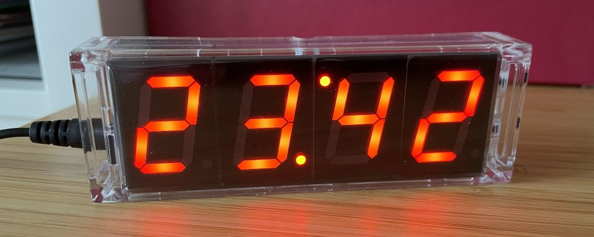

# Firmware replacement for DIY LED Clock kits based on STC microcontrollers

This is a replacement firmware for Digital LED Clock DIY kits that are built around STC microcontrollers (these are uCs using the 8051 instruction set, but are much faster, as they use less cycles per instruction) and which can be found on various (mostly Chinese) sources.

This project was originally based on the repository [aFewBits/stc-led-clock](https://github.com/aFewBits/stc-led-clock), to which all due credit shall hereby be given - thanks for all the foundation work!

---

There's **a lot** of improvements and new features in this new version (see [below](#clock-features)), making this - in my humble opinion - the best firmware for those cheap clocks out there and there's no reason at all to use _any_ other firmware (especially not the stock firmware) anymore, ever!!! 😉

---

**Example image of such a clock:**



**More images** of this clock with the new firmware:
[Time display](doc/images/clock_time.jpg), [Temperature display](doc/images/clock_temp.jpg), [Date display (German date format)](doc/images/clock_date_german.jpg), [Snake Animation](doc/images/clock_snake.jpg)

**Example videos** of this clock with the new firmware in action:
[Display Auto-Rotation](https://www.youtube.com/watch?v=UyDxDATHdGQ), [Snake Animation](https://www.youtube.com/watch?v=N_o87PTVPpA)

**User Manual**: See [Operating Instructions](#operating-instructions) (also available as [PDF](https://raw.githubusercontent.com/fabianswebworld/stc-led-clock-firmware/main/doc/operation_instructions.pdf)).

**Enjoy!**

## Clock Features

These are the features of this clock firmware. Features added by me in this version (initial public release, v1.2.0) are highlighed with "**NEW:**".

* Time display (12 and 24 hour modes)
* Alarm (using the rather loud internal buzzer)
* Hourly chime (operating hour range programmable, on/off selectable)
* Automatic date and day of week display (on/off selectable)
* Automatic Ambient Temperature display (°C/°F selectable, on/off selectable)
* Seconds display with possibility to reset seconds to 00
* Display Auto-Dim with programmable limits (auto-dim can be disabled using the limits)
* Temperature calibration
* Auto-increment when setting times/alarms/etc. by holding the set key - no need to repeatedly press the same key
* Support for "talking clock" that uses the NY3P065 sound chip in both 24 and 12 hour modes
* **NEW:** Flicker-Free display (156.25 Hz refresh rate and Dual-Edge Boundary Modulation)
* **NEW:** Smooth Fade-In/Out when changing between Time, Temperature, Date, Day and Seconds display
* **NEW:** Smoothly blinking colon dots in Time display mode, imitating the glow of incandescent light bulbs
* **NEW:** Greatly improved auto-dimming, reacting smoothly to changes in ambient lighting conditions
* **NEW:** Count-down timer (long-press S2 to enter, S1/S2 add minutes/seconds, both to reset to 00.00; auto start, long press S2 to leave)
* **NEW:** Stop Watch, displaying of hundredths of seconds, up to 99:99 (99 seconds, 99 hundredths)
* **NEW:** Snooze Timer for Alarm (press S1 to snooze, S2 to cancel alarm)
* **NEW:** Auto-rotation of the enabled display modes (Temperature, Date, Day of Week), configurable
* **NEW:** Display hold time per mode (1-5 seconds) and frequency of auto-rotation per minute (0-3 times) configurable
* **NEW:** Manual advance through the enabled modes is possible (Seconds display has been added to the end of them)
* **NEW:** Year setting (displayed only in manual mode advance, before the Seconds display), automatically accounting for leap years
* **NEW:** Date validation (in origial firmware it was possible to set dates like e.g. February 30th or April 31st)
* **NEW:** Leading zero display (9:00 vs. 09:00) now configurable via config menu
* **NEW:** For the EU date format the dot after the month (DD.MM.) can be enabled, as this is usual e.g. in Germany
* **NEW:** In 24-hour mode, the decimal point of the last digit is used to indicate whether Alarm is on
* **NEW:** A fun little Snake animation on the top of the hour (or every half hour etc., selectable) or by long-press of S1

## Getting Started

You'll need [SDCC](http://sdcc.sf.net) to build and [STC-ISP](http://www.stcmcudata.com/STCISP/stc-isp-15xx-v6.86D.zip) or [stcgal](https://github.com/grigorig/stcgal) to set the clock speed, processor hardware options and to flash the firmware. I personally recommend **stcgal**, it works very well and is free and open-source.

**Quick Start:** For 99% of the DIY clock kits out there (using the STC15W408AS with 8KB of flash) you can use the readily-built `main.hex` file from this repository, flash it, and use your clock as described in the [Operating Instructions](#operating-instructions) (also available as [PDF](https://raw.githubusercontent.com/fabianswebworld/stc-led-clock-firmware/main/doc/operation_instructions.pdf)). Enjoy!

**Important note:** Since the addition of all the above features increased code size to almost 8KB, this firmware replacement is _only_ suitable for clocks with 8KB microcontrollers, not for ones featuring only 4KB. This should not be a problem since all clocks I ever encountered on the market had the STC15W408AS mentioned above, but you should double-check.

In addition to the above tools, you will need one serial port with TTL outputs for programming the STC processor. The simplest solution is usually an inexpensive USB to serial TTL converter. These can be based on the FT232 chipset, PL2303 or CH340. They all work equally well, it's just a matter of what you find at the ready when you need it.

The features above are implemented with a multi-level menu with best-as-can-be-managed text prompts using the limited 7 segment displays. A detailed operation guide is given below.

### Programming with STC-ISP

Connect to the STC processor using the four pin header (which hopefully you installed prior to soldering the four LED display in place). If your clock is already built and your desoldering skills and/or tools are not up to the task, you can solder the necessary header(s) using wire between the header(s) and the top of the board.

 ----------------------------
| P1 header | Serial adapter |
|-----------|----------------|
| 5V        | 5V             |
| GND       | GND            |
| RXD/P3.0  | TXD            |
| TXD/P3.1  | RXD            |
 ----------------------------

Once you're connected, you have your choice of either STC-ISP, which is a Windows application (runs fine on most VM's), or you can use [stcgal](https://github.com/grigorig/stcgal) which runs on Python and which I generally prefer. Once your tool is running, you'll need to load the .HEX output file into the processor, set the Clock speed to 22.1184 MHz (see below for details), and flash it.

#### How to program using STC-ISP:

* Select the correct processor type
* Select COM port (usually auto seclected)
* Open code file (usually main.hex)
* Select clock speed of 22.1184 MHz on the Hardware Option tab
* Click the Download/Program button
* Interrupt the +5 supply to the STC processor and restore

### How to program using stcgal:

* `sudo chmod 666 /dev/ttyUSB0`
* `stcgal -p /dev/ttyUSB0 -P stc15 -b 19200 -t 22118.4 -o clock_source=internal /path/to/main.hex`

The above commands are example commands to flash the usual STC15-family uCs with a reasonable baud rate and using the default interface, /dev/ttyUSB0 (the first command is a quick fix to ensure your normal user has the rights to open the serial port, it must be repeated each time you disconnect/reconnect your USB-TTL adapter, and might be different dependent on your OS/distribution).
Adjust the port (-p), processor type (-P), and path to your .hex file to your needs.

---

## Operating Instructions

### 1. Buttons and indicators

The clock is operated using two push-buttons located on the side or rear of the unit:
* **Button 1 (S1, top):** Settings menu / Advance menu item / Select value
* **Button 2 (S2, bottom):** Next display page / Select menu item / Increment value / Functions menu

The dots on the display are used as indicators:
* **Center Colon (`:`):** Flashes once per second with an incandescent filament effect (gradual ignition and afterglow decay).
* **Indicator Dot:**
  * **In 24-hour display mode:** The decimal point at the lower-right corner of the fourth digit stays steadily lit when the daily alarm is armed.
  * **In 12-hour display mode:** The decimal point at the lower-right corner of the fourth digit indicates PM.

In normal operation, the clock displays the current hours and minutes. Additionally, at configurable intervals, an "auto-rotation" through other items (Temperature, Date, Day of Week) is performed. For each of these three items (Temperature, Date, Day of Week), the inclusion in the auto-rotation can be enabled or disabled.

### 2. Actions from normal time display

* **Button 1 (Short press):** Enters the Settings menu (see Section 7).
* **Button 1 (Hold for 1 second):** Launches the 7-segment Snake animation manually.
* **Button 2 (Short press):** Steps to the next display page (see Section 3).
* **Button 2 (Hold for 1 second):** Enters the Functions menu (see Section 4).

### 3. Manual display of other information

Pressing **Button 2** steps through the available information displays in sequence:

```
Time -> Temperature -> Date -> Day of Week -> Year -> Seconds -> Time
```

* **Temperature:** Displays ambient temperature (e.g., `22°C` or `72°F`).
* **Date:** Displays month and day according to the selected format (e.g., `31.12.`, `31.12`, or `12.31`).
* **Day of Week:** Displays three-letter abbreviation of the current weekday.
* **Year Display (`'xx`):** Displays the last two digits of the year preceded by an apostrophe at the top (e.g., `'26` for 2026). The internal clock circuit automatically calculates leap years.
* **Seconds Display (`MM.SS`):** Displays elapsed minutes on the left digits and running seconds on the right digits.
  * **Time Synchronization:** Pressing **Button 1** while on this page immediately resets the seconds counter to `.00` to synchronize with a reference clock.

When manually advancing the modes, all of the above pages are displayed, regardless of whether they are also enabled for the auto-rotation in the `dISP` menu (see Section 5).
A page selected manually with **Button 2** stays on the screen indefinitely, the clock will not switch back automatically.

* **Returning to Clock:** Pressing **Button 2** repeatedly until the hours and minutes return restores normal timekeeping and re-enables automatic rotation.

### 4. Countdown Timer (`Ctdn`) and Stopwatch (`Stop`)

A countdown timer and a stopwatch are available from the Functions Menu.

#### 4.1 Accessing the Functions Menu

1. **Activation:** While in normal clock mode, **press and hold Button 2**. The display shows `Ctdn`.
2. **Menu Navigation:**
   * **Button 1:** Cycles through the available functions: `Ctdn` -> `Stop` -> Back to normal clock display.
   * **Button 2:** Confirms and enters the selected function. From any of the functions, you can **hold Button 2** to return to the normal clock display.

#### 4.2 Countdown Timer (`Ctdn`)

1. **Setting the Duration (`MM:SS`):**
   * The display shows the last used timer preset (factory default: `00:59`). The colon remains steady.
   * **Button 1:** Increments minutes (from `00` up to `99`).
   * **Button 2:** Increments seconds (from `00` up to `59`).
   * **Button 1 + Button 2 (simultaneously):** Resets the timer to `00:00`.
   * **Hold Button 2:** Cancels the countdown and returns to normal clock display.
2. **Automatic Start:**
   * After not pressing any button for **2 seconds**, the countdown begins automatically (the chosen starting value is saved to memory as the new default preset).
   * The colon flashes while counting down.
3. **While Running:**
   * Pressing any button while running immediately pauses the countdown and returns to the Duration setting, allowing you to add more time, starting from the current value.
   * **Hold Button 2:** Cancels the countdown and returns to normal clock display.
4. **Timer Alarm:**
   * When reaching `00:00`, the display flashes rapidly and the buzzer sounds.
   * **Pressing either Button 1 or Button 2** silences the alarm and immediately returns to the normal clock display.

#### 4.3 Stopwatch (`Stop`)

1. **Display Format (`SS.hh`):**
   * Displays seconds and hundredths of a second (`00.00` to `99.99`).
   * The stopwatch always initializes to `00.00` (paused) upon entry, with the top indicator dot illuminated steady.
2. **Controls:**
   * **Button 1:** Starts or pauses the stopwatch.
   * **Button 2 (while paused):** Resets the display back to `00.00`.
   * **Hold Button 2:** Exits the stopwatch and returns to normal clock display.
3. **While Running:**
   * The hundredths digits run continuously at high speed, and the top indicator dot blinks.
   * You can pause and resume timing as often as needed.
   * Upon reaching `99.99` seconds, the stopwatch automatically rolls over to `00.00` and continues counting uninterrupted.

### 5. Automatic Display Rotation

If enabled in the `diSP` menu (see Section 7), the clock will smoothly dissolve from the time display through the enabled information pages (Temperature, Date, Day of Week) before returning to the clock. This rotation can be configured in the `dISP` menu (see Section 7):

* **Cadence/Interval Options (`rot`):**
  * `rot0`: Automatic rotation disabled (manual cycling only).
  * `rot1`: Once per minute (at second :30).
  * `rot2`: Twice per minute (at seconds :00 and :30).
  * `rot3`: Three times per minute (at seconds :00, :20, and :40).
* **Page Duration (`dur`):**
  * Configurable from **`dur1` to `dur5`** (each page holds for 1 to 5 seconds).

### 6. Hourly animation (`Ani`)

A fun little snake animation starts: the snake slithers across the display segments, locates "apples", grows in length, and dissolves back into the clock display. The animation lasts for approximately 16 seconds and can be cancelled at any time by pushing one of the buttons, exiting back to normal time display.

* **Cadence Options (`Ani`):**
  * `Ani0`: Animation disabled.
  * `Ani1`: Twice daily (at 12:00 noon and 00:00 midnight).
  * `Ani2`: Once every hour (at the top of the hour, :00), default.
  * `Ani3`: Every half hour (:00 and :30).
  * `Ani4`: Every quarter hour (:00, :15, :30, :45).
  * `Ani5`: Every minute (at second :00).
* **Manual Trigger:** Holding **Button 1** for 1 second in normal clock mode launches the animation immediately.

### 7. Settings Menu

Press **Button 1** from normal clock mode to enter the Settings menu tree.  
* Use **Button 1** to cycle through the four top-level menus (`SEt`, `bEEP`, `diSP`, `ConF`).
* Use **Button 2** to enter a menu.
* Inside any setting: **Button 2** changes the value, **Button 1** confirms and advances to the next setting.

```
[Normal Clock]
     |
  (Button 1)
     |
     +---> [ SEt  ] ---> Clock Time -> Alarm Time -> Chime Hours (begin/end) -> Date -> Day of Week -> Year
     |
     +---> [ bEEP ] ---> Alarm Toggle -> Hourly Chime Toggle
     |
     +---> [ diSP ] ---> Temperature Enable -> Date Enable -> Day of Week Enable -> Rotation cadence -> Page duration -> Animation cadence
     |
     +---> [ ConF ] ---> 12/24h -> Leading Zero -> Temperature Unit -> Date Format -> Brightness -> Temperature Calibration -> Firmware Version
```

#### Menu 1: Set Clock, Alarm, Date (`SEt`)

Press **Button 2** on `SEt ` to enter the setting sequence:
1. **Clock Time (`CL`):** Hours flash -> press **Button 2** to adjust -> press **Button 1** -> Minutes flash -> press **Button 2** to adjust -> press **Button 1**.
2. **Daily Alarm Time (`AL`):** Alarm hours flash -> adjust with **Button 2** -> press **Button 1** -> Alarm minutes flash -> adjust with **Button 2** -> press **Button 1**.
3. **Hourly Chime Window (`CH`):** Sets active hours for the chime.
   * Start Hour flashes -> adjust with **Button 2** -> press **Button 1**.
   * End Hour flashes -> adjust with **Button 2** -> press **Button 1**.
4. **Date (`DA`):** Month flashes -> adjust with **Button 2** -> press **Button 1** -> Day flashes -> adjust with **Button 2** -> press **Button 1**.
5. **Day of Week (`DY`):** Day flashes -> press **Button 2** to adjust (Sun ... Mon) -> press **Button 1**.
6. **Year (`Yr`):** Year flashes -> press **Button 2** to adjust (00 ... 99) -> press **Button 1** to save and exit to clock.

#### Menu 2: Sound Settings (`bEEP`)

Press **Button 2** on `bEEP` to enter:
1. **Alarm Enable:** Displays `AL on` or `AL oF`. Press **Button 2** to toggle. Press **Button 1** to confirm.
2. **Chime Enable:** Displays `CH on` or `CH oF`. Press **Button 2** to toggle. Press **Button 1** to confirm and exit to clock.

#### Menu 3: Display Settings (`diSP`)

Press **Button 2** on `diSP` to enter settings for the display rotation:
1. **Temperature Page:** Displays `tP on` or `tP oF`. Press **Button 2** to toggle. Press **Button 1** to advance.
2. **Date Page:** Displays `dA on` or `dA oF`. Press **Button 2** to toggle. Press **Button 1** to advance.
3. **Day of Week Page:** Displays `dy on` or `dy oF`. Press **Button 2** to toggle. Press **Button 1** to advance.
4. **Auto-Rotation Cadence (`rot`):** Displays `rot0`, `rot1`, `rot2`, or `rot3` (see Section 5). Press **Button 2** to cycle. Press **Button 1** to advance.
5. **Page Duration (`dur`):** Displays `dur1` to `dur5` (duration in seconds that each page of the rotation is displayed). Press **Button 2** to cycle. Press **Button 1** to advance.
6. **Animation Cadence (`Ani`):** Displays `Ani0` to `Ani5` (see Section 6). Press **Button 2** to cycle. Press **Button 1** to save and exit to clock.

#### Menu 4: Configuration (`ConF`)

Press **Button 2** on `ConF` to enter configuration settings:
1. **Time Format (`12.24`):** Press **Button 2** to toggle between `12` (12-hour AM/PM) and `24` (24-hour). Press **Button 1** to advance.
2. **Leading Zero Suppression (`ZEro`):** Press **Button 2** to toggle between `09:59` (leading zero visible) and ` 9:59` (leading zero blanked). Press **Button 1** to confirm and advance.
3. **Temperature Unit (`Unit`):** Press **Button 2** to toggle between `°C` (Celsius) and `°F` (Fahrenheit). Press **Button 1** to advance.
4. **Date Format (`DATE`):** Press **Button 2** to cycle through:
   * `12.31` (Month.Day)
   * `31.12` (Day.Month)
   * `31.12.` (Day.Month with trailing point, German format)
   * Press **Button 1** to confirm and advance.
5. **Automatic Dimming Range (`brt`):**
   * Press **Button 2** to set maximum brightness level (01 ... 63).
   * Press **Button 1**, then **Button 2** to set minimum (night-time) brightness level (01 ... 63).
   * Press **Button 1** to advance.
6. **Temperature Sensor Calibration (`CALI`):**
   * Press **Button 2** to enter -> current temperature reading is displayed.
   * Press **Button 2** to increment offset (-15 ... +15 degrees).
   * Press **Button 1** to advance.
7. **Firmware Version Display (`vEr`):**
   * Press **Button 2** to enter -> display shows installed firmware revision (e.g. `1.2.0 `).
   * Press **Button 1** to exit to clock.

### 8. Backup Battery

The clock uses an onboard CR1220 3V coin cell battery to back up the DS1302 real-time clock circuit. 

* **Retained Data:** Timekeeping, leap-year calculations, alarm settings, rotation preferences, countdown presets, and sensor calibrations are retained in non-volatile battery-backed memory.
* **Mains Reconnection:** When main power is disconnected and restored, the display immediately resumes operation with current time and customized settings intact without requiring reconfiguration.

### 9. Factory reset

To reset the clock to its factory defaults or to initialize in case of corrupt data in the RTC RAM, please follow these instructions:
* Remove power
* Press and hold **both buttons** (S1 and S2)
* While holding the buttons, reapply power
* After 1 second, release the buttons. The display will go blank and as soon as both buttons are released, display the Snake Animation once (~ 16 s) to confirm reset. To skip the animation, press any button during the animation, which will exit to normal clock display (0:00).
* The clock defaults to the following settings: 24-hour, DD.MM. format, leading zero suppression on, temperature unit °C, automatic display of temperature and date enabled, Snake animation enabled at top of hour.

---

## Making changes to the code

It is a simple matter to rebuild with the provided Makefile for SDCC. The Makefile originated with zerog2k's STC DIY-Clock project and was extended by aFewBits in the above-mentioned repository.

The code heavily uses _#ifdefs_ so you can disable sections you don't need or your hardware doesn't support (e.g., the Snake animation or the Speech chip) to make more room in Flash for new ideas.

If you want to make any significant code changes, you'll probably wish you had some debugging capability. If you have the STC15W408AS part in your clock, you're in luck as this processor has a second timer and UART. The code already has initialization in place for this UART if turned on in the global.h header file. SDCC supports a small footprint printf (printf_tiny) that only requires about 400 additional bytes of flash. The timer 2 default configuration is for 115200 baud, 8/1/N. On the Banggood board, the RX and TX have separate pins on a two pin connector, P3. Connection to a serial device is:

 ----------------------------
| P3 header | Serial adapter |
|-----------|----------------|
| P3.6      | TXD            |
| P3.7      | RXD            |
 ----------------------------

In order to pick up the GND connection, you'll need to parallel the main serial port on P1. The connections for P1 are detailed in the previous section.

### Program Assumptions

The CPU clock is set to run at 22.1184MHz. In *aFewBits*'s version, the clock tick was 50us, but in order to further increase refresh rate (as I noticed the ~75Hz flicker in peripheral vision), I changed this first to 25us but in order to get more dimming steps, I even went as far as 12.5us. This is as smooth as can be and still the CPU is not loaded more than around 25%.

More details on the origins of this can be found in the original repository.

## Authors

* **R Sloyer** - *Initial work* - [aFewBits](https://github.com/aFewBits)
* **Fabian Schneider** - *Modifications and new features* - [fabianswebworld](https://github.com/fabianswebworld)
* **Contributors** - *see this GitHub repository's list of contributors*

## License

This project is licensed under the MIT License - see the [LICENSE.md](LICENSE.md) file for details.

To all vendors and distributors of those DIY clock kits: **Feel free to use this firmware** for your kits, but please include a short notice in your documentation/leaflet regarding the source, and ideally include a copy of the MIT license text, which is only a few lines.

## Disclaimers

This code is provided as-is, with NO guarantees or liabilities, as per the License. Use at your own risk.

Since the original firmware loaded on the STC processor cannot be copied, there is no duplicating what you originally received with your clock. If you want to retain this code for any reason, you must purchase another STC chip of the same type (or same base type with more flash if desired or needed). These are readily available from various online sources.

## Acknowledgments

* [zerog2k](https://github.com/zerog2k) for his original STC DIY Clock work
* [aFewBits](https://github.com/aFewBits) for his modifications in the stc-led-clock project
* STC and zerog2k for the ADC code used in the LDR and temperature measurement code
* Jack Ganssle et al at The Embedded Muse for the [initial switch debouncing idea](http://www.ganssle.com/debouncing.htm)
* Maxim Integrated for their DS1302 app note and [8051 example code](https://www.maximintegrated.com/en/app-notes/index.mvp/id/3449)
* All the contributors to the SDCC tool set

## References

STC15 series English datasheet:
http://www.stcmcu.com/datasheet/stc/STC-AD-PDF/STC15-English.pdf

Older STC15F204EA English datasheet:
http://gxwmcu.com/datasheet/stc/STC-AD-PDF/STC15F204EA-series-english.pdf

SDCC User Guide (PDF):
http://sdcc.sourceforge.net/doc/sdccman.pdf

Maxim DS1302 datasheet:
http://datasheets.maximintegrated.com/en/ds/DS1302.pdf

Maxim DS1302 application note 3449 with example code for 8051 interfacing:
https://www.maximintegrated.com/en/app-notes/index.mvp/id/3449
